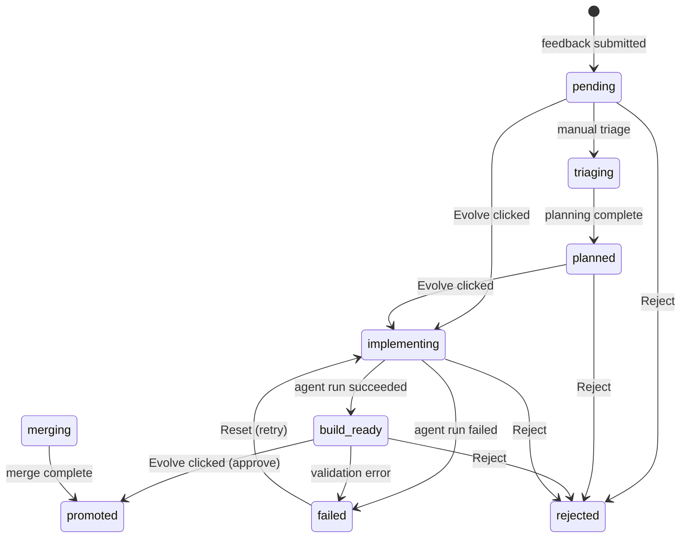

# Evolvo concepts

This document explains how Evolvo works and why it is built the way it is.
It is not a tutorial (see `docs/tutorial-first-newapp.md` when it exists)
and not an API reference. It is the explainer you read before you build
anything, or before you explain Evolvo to someone else.

After reading this you should be able to:

- Explain Evolvo at a meetup in 90 seconds.
- Understand what the lineage model is and why it is the product.
- Know which invariants are non-negotiable and why.
- Pick an agent backend for your situation.
- Know what "forking a lineage" means in practice.

---

## 1. What VibeCoding is — and the shape Evolvo implements

In early 2025, Andrej Karpathy named a practice that had been happening for
months without a name: *vibe coding* — steering an AI agent with natural
language, sketches, and intent rather than with typed-out specifications. The
result is faster, rougher, and harder to audit than traditional development.

Every major vibe-coding tool (Cursor, Replit, Lovable, Bolt, v0) optimises
for the moment of creation: you describe what you want, the agent produces
code, the code ships. The workflow is fast. The problem is that *it forgets*.
There is no record of why iteration 7 looks different from iteration 3, no
way to go back to a known-good point without digging through git, no way to
hand a half-built product to someone else and say "here is everything that
led to this."

Evolvo implements a specific shape of vibe coding:

> **Feedback-driven, lineage-first, human-gated.**

- *Feedback-driven*: every change begins with a piece of feedback from the
  user — a sketch, a voice note, a pasted screenshot, a typed request — given
  on the page the user is actually looking at.
- *Lineage-first*: each piece of feedback becomes a node in a tree. The tree
  is portable, forkable, and reviewable. It is not a log; it is a first-class
  artifact.
- *Human-gated*: the agent never writes to your source without an explicit
  approval click. You see the diff. You run the iteration. You decide.

The tagline is: **vibe coding with a memory.** The memory is the lineage.

---

## 2. The lineage model

### 2a. From feedback to iteration

The core loop in Evolvo has four steps:

```
1. You submit feedback on the running app.
2. A lineage job is created automatically.
3. An agent runs in an isolated worktree and produces a new version.
4. You review, run, and approve or reject it.
```

Step 1 happens through the canvas overlay — a transparent drawing surface
that opens on top of every page in the app. You can sketch, type, paste
images, or record a voice note. When you submit, the feedback record is
written to `~/.evolvo/evolvo_workspace/feedback/{id}.json`.

Step 2 is automatic. The lineage engine reads the feedback and creates a
`LineageJobRecord` in `lineage_jobs/{id}.json`, initially in `pending` status.
The two records are linked by `feedback_id` and `lineage_job_id` fields.

Step 3 begins when you click **Evolve** in the Lineage tab. The runner forks
the source repo into a git worktree, launches the agent CLI against that
worktree, and streams the output to a log file. The job advances through
`implementing` → `build_ready` as the agent works. The worktree is isolated —
the agent cannot touch your main branch.

Step 4 is yours. The Lineage tab shows you the iteration's status, its notes,
its pipeline stages (for NewApp iterations), and the worktree path. You can
click **Run** to launch the iteration's app locally on its own port and verify
it works. Clicking **Evolve** again with the job in `build_ready` promotes it.
Clicking **Reject** marks it terminal.

### 2b. The state machine



| Status | Meaning |
|---|---|
| `pending` | Job created, not yet started. Evolve is available. |
| `triaging` | A maintainer is manually reviewing the feedback before running. |
| `planned` | A plan has been recorded; ready to implement. |
| `implementing` | Agent is running in the worktree. |
| `build_ready` | Agent finished; iteration is ready to review and promote. |
| `merging` | Merge in progress (reserved for future automation). |
| `promoted` | You approved it. This is the terminal success state. |
| `rejected` | You rejected it. Terminal. Cannot be undone. |
| `failed` | The agent run ended in error. You can Reset and retry. |

### 2c. Notes, stages, and status

A lineage job has three distinct progress surfaces:

**Status** is the current state machine position (table above). It is the
coarse-grained view: "is this done, running, failed, or approved?"

**Notes** are a plain-text append-only log on the job record. Every
significant event appends a note: "run requested," "retry cleanup failed,"
"user clarification: …," etc. Notes are the audit trail — they explain *why*
the status is what it is.

**Stages** exist only on NewApp iterations (see §2d). They are the
fine-grained pipeline breakdown: which planning and implementation stages ran,
in what order, and whether each passed validation.

### 2d. Single-session vs. multi-stage pipeline

Evolvo uses two execution paths depending on what the feedback asks for.

**Single-session** (the default): a bug fix, an improvement, a small feature.
The agent runs once in the worktree, produces its output, and the job flips to
`build_ready`. One log file (`claude.log`, `codex.log`, etc.), no stage
breakdown.

**Multi-stage pipeline** (NewApp iterations with a canvas annotation): when
you submit a `new_app` feedback type with a canvas sketch, Evolvo routes the
job through a structured seven-stage pipeline:

```
backend_plan → backend_impl → frontend_plan → frontend_impl
             → e2e_plan → e2e_impl → final_review
```

Each stage is a separate agent invocation with a narrower prompt. The stages
are persisted as `StageState` objects on the job record, so if the pipeline
fails at stage 4, **Resume** re-enters at stage 4 without re-running stages
1–3. Each stage has its own log file under the job's workspace.

---

## 3. The four invariants

These are not features. They are the product. Every change to Evolvo —
including yours — must preserve all four.

### I-P1. Lineage always stays

The feedback → lineage job pipeline is permanent. It cannot be feature-flagged
off, conditionally compiled away, or bypassed for "simple" feedback. The whole
point of Evolvo is that the lineage exists. An Evolvo without a lineage is a
notepad with a button.

*Why this matters to you:* If you are building a NewApp on top of Evolvo, your
users' feedback is automatically tracked in a tree you can hand to a reviewer,
bundle into a `.evolvo-bundle`, and resume from anywhere. That tree does not
exist if I-P1 is compromised.

### I-P2. Feedback Overlay always stays

The canvas + feedback submission surface is always reachable from every page,
every mode, every route of the app. There is no screen where the Feedback FAB
is absent. No "pro mode" that hides it. No route that orphans the user.

*Why this matters to you:* The feedback capture is what produces the lineage.
If a user cannot reach the overlay on the page they want to give feedback
about, the feedback is lost — or worse, it is filed about the wrong page.

### I-P3. The Canvas is a per-page overlay, not a tab

The drawing surface must be invokable *on top of* whatever the user is
currently looking at. It is not a dedicated canvas route; it is a transparent
overlay that annotates the real page. This is what makes the screenshot
attached to a feedback row useful: it captures the page context plus the
user's strokes, not a blank canvas.

*Why this matters to you:* If you rewrite the NewApp content in `app.rs`,
the canvas overlay continues to work because it is owned by `shell.rs`, which
wraps every page. You cannot accidentally break it by working in the content
layer — but you can break it by trying to move it into the content layer.

### I-P4. Lineages are saveable and forkable

A lineage — the feedback record, the job, the attachments, the agent log — is
a portable, self-contained artifact. You can export any job as a
`.evolvo-bundle` file (tar archive with host-specific paths stripped) and
import it into a fresh workspace on a different machine. The imported lineage
becomes a new Evolvo-shaped app with its own identity, independent of the
original.

*Why this matters to you:* This is what makes Evolvo a *builder* rather than
a *notebook*. An iteration that worked well is not locked to the machine that
produced it. You can fork it, rename it, ship it to a collaborator, or start a
new product line from it.

---

## 4. The agent backends

Evolvo supports three agent CLIs. They are interchangeable at the pipeline
level — every backend receives the same structured prompt and produces output
into the same worktree. The differences are in auth model, output format,
and practical behaviour.

Evolvo discovers which backends are available by probing the enriched PATH
(see [`docs/INSTALL.md`](INSTALL.md) §5 for the probe list) at startup.
Backends whose binary is absent are greyed out in the Feedback panel. The
availability check is cached per process — relaunch Evolvo after installing a
new CLI.

### Claude Code (`claude`)

The default backend and the most thoroughly tested with Evolvo. Claude Code
runs non-interactively with `claude -p <prompt> --dangerously-skip-permissions
--output-format stream-json --verbose`. The `stream-json` flag produces
JSONL tool events that Evolvo stores in `claude.log`; you can inspect them
post-run with `jq` to see exactly what the agent read and wrote.

**Auth:** Anthropic subscription (OAuth). Evolvo removes `ANTHROPIC_API_KEY`
and `ANTHROPIC_AUTH_TOKEN` from the environment before spawning — a
zero-balance API key would shadow a valid subscription and cause billing
errors. Run `claude` once interactively to complete login.

**Best for:** Complex multi-stage NewApp iterations, tasks that require deep
reading of `CLAUDE.md` and the rule files, iterative refinement.

**Context file at worktree root:** `CLAUDE.md` (also `.claude/agents/`,
`.claude/rules/`).

### Codex CLI (`codex`)

OpenAI's agent CLI. Spawned as `codex exec --json
--dangerously-bypass-approvals-and-sandbox <prompt>`. Output is JSONL with a
different schema from Claude's — `tool_call` / `tool_result` events rather
than `tool_use` entries nested inside message content.

**Auth:** `OPENAI_API_KEY` in the environment.

**Best for:** Tasks where you have OpenAI credits and prefer GPT-4o or o3;
teams already using the OpenAI ecosystem.

**Context file at worktree root:** `AGENTS.md` (symlinked to `CLAUDE.md` by
the runner).

### Grok CLI (`grok`)

xAI's Grok Build CLI (installed under `~/.grok/bin`). Spawned as `grok -p
<prompt> --always-approve --cwd <worktree> --output-format
streaming-messages-json`. Output is NDJSON in the same envelope as Claude's
stream-json, so `grok.log` can be inspected with the same `jq` recipes as
`claude.log`.

**Auth:** Run `grok login` once per host.

**Context file at worktree root:** `AGENTS.md` (symlinked to `CLAUDE.md`).
Grok only auto-loads it in folders it trusts, so Evolvo's prompts tell the
agent to read the project guide explicitly.

> **Retired backends:** Gemini CLI and Forge are no longer supported. Job
> records that used them (including older `open_code` records) still load and
> are labelled "(retired)" in the Lineage tab; retrying or resuming such a
> job runs it with Claude Code.

---

## 5. Trust and safety

Every iteration the agent produces lives in an isolated git worktree until you
approve it. The agent cannot push, merge, or touch your main branch. It writes
files in `~/.evolvo/evolvo_workspace/lineage_workspaces/<job-id>/` — outside
the repo — and in the worktree it was given.

The approval gate is not a formality. It is the product's core safety property.
When you click **Evolve** on a `build_ready` job, you are the last human in the
loop. The diff you saw, the iteration you ran, the behaviour you verified — that
is the contract. If you did not run it, you should not approve it.

Evolvo runs entirely locally by default. There is no server, no analytics call,
no telemetry. The workspace is plain JSON files on your disk; `cat` any of them
at any time to verify what is stored.

For reporting security issues in the code itself, see
[`SECURITY.md`](../SECURITY.md) (forthcoming).

---

## 6. Forking and portability (I-P4 in practice)

Any lineage job can be exported as a `.evolvo-bundle`:

1. Open the Lineage tab.
2. Select the job you want to fork.
3. Click **⋯ → Fork…** and choose a destination directory.

The bundle is a tar archive containing:

- The `LineageJobRecord` JSON.
- The `FeedbackRecord` and all its attachments (canvas PNG, pasted images,
  voice file).
- A `manifest.json` with schema version, app name, and export timestamp.

Host-specific paths are stripped. The bundle has no reference to your machine.

To import a bundle into a fresh workspace:

1. Click **Open bundle…** in the Lineage sidebar.
2. Enter the path to the `.evolvo-bundle` file.
3. Enter a target workspace root (must be empty or non-existent).

The importer unpacks the bundle, writes the feedback and job records, restores
attachments, and reports how many items were imported. You then launch a new
Evolvo instance pointed at that workspace:

```bash
EVOLVO_WORKSPACE_ROOT=/path/to/new-workspace cargo tauri dev
```

The imported lineage is now the history of the new app. You can continue
evolving it, share it with a collaborator, or use it as the starting point for
a different product. This is what "the lineage is the product" means in
practice: it is portable, transferable, and not tied to any one machine or
account.

---

## Glossary

| Term | Meaning |
|---|---|
| **Lineage** | The tree of feedback rows, jobs, and iterations that document how an app became what it is. |
| **Iteration** | One agent run + the code it produced + your review decision. A node on the lineage tree. |
| **Worktree** | A git worktree forked from the source repo where the agent writes code. Isolated from the main branch until you promote. |
| **Vibe** | Informal: a user's lineage as a shareable artifact ("share your vibe", "fork someone else's vibe"). |
| **NewApp** | A feedback type that triggers the multi-stage pipeline instead of a single-session run. Used when you are asking the agent to build a new application from scratch on top of the Evolvo shell. |
| **Bundle** | A `.evolvo-bundle` tar archive containing one job + its feedback + attachments, with host paths stripped. The portable unit of I-P4. |
| **Shell** | `app/ui/src/shell.rs` — the invariant chrome that owns the Feedback FAB, Canvas overlay, Lineage tab, and app bar. It wraps every page of every NewApp. |
